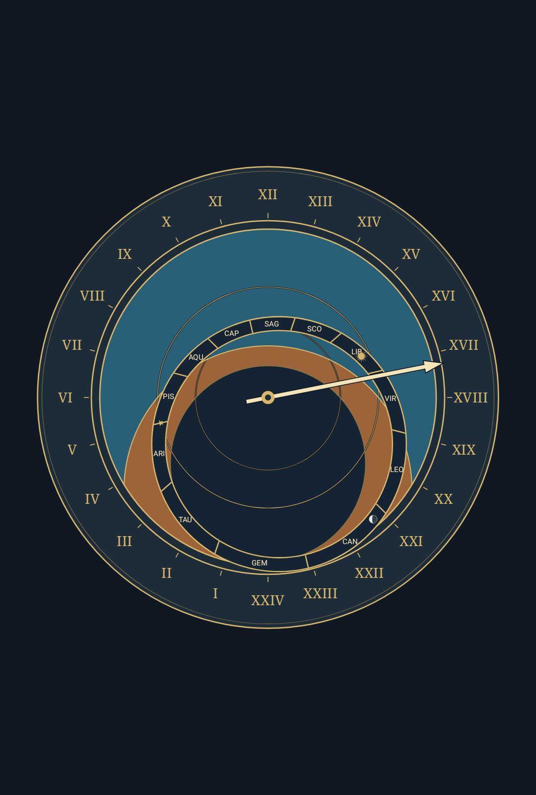
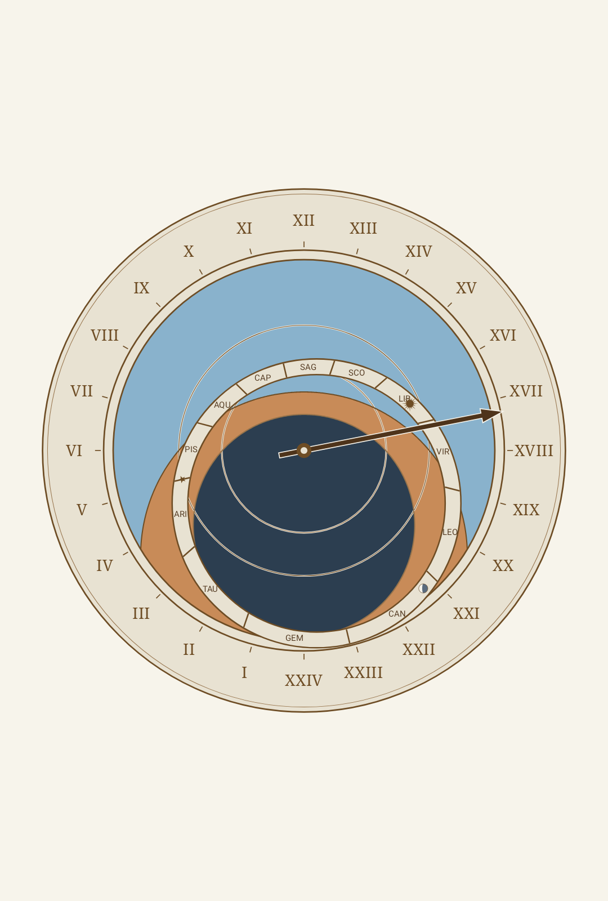
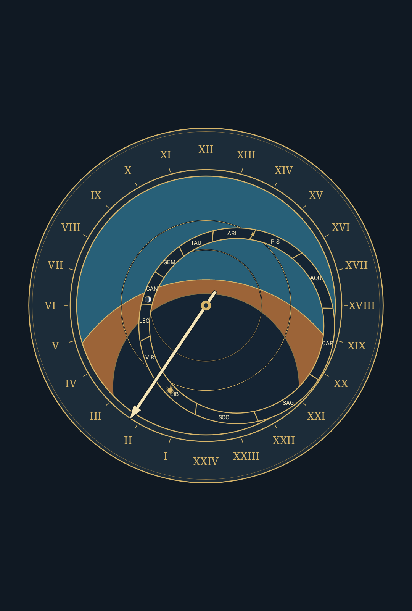
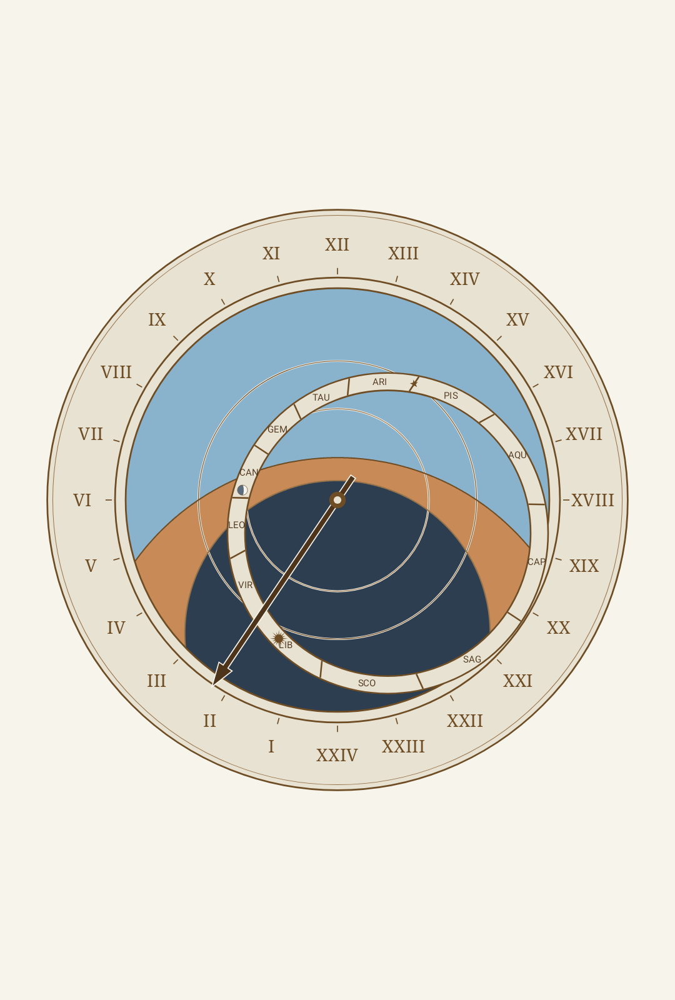
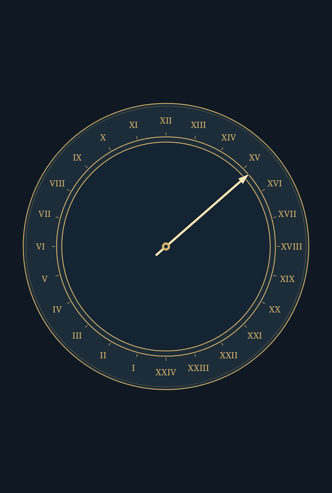
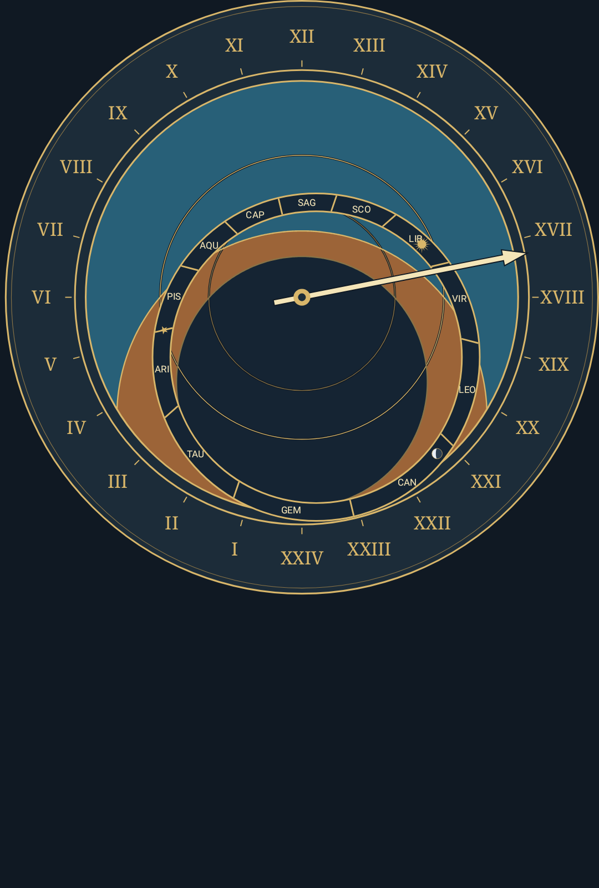

# Reviewed Wallpaper Visuals and Evidence Specification

This document maintains a curated set of representative wallpaper screenshots for the Astronomical Clock Wallpaper project, establishes evidence classification rules, and defines review and refresh ownership across contributors and maintainers.

---

## 1. Representative Visual Gallery

The images below represent the rendered live wallpaper experience across core configurations.

### 1.1 Northern Hemisphere — Prague Orloj (50.08°N, 14.42°E)

Default historical instrument dial projection with all layers active (Sun, Moon, Zodiac ring, 24-hour civil hand).

| Dark Appearance | Light Appearance |
| :---: | :---: |
|  |  |
| **Evidence**: Host Canvas API 36 (`prague-dark-api36.png`) Resolution: 1080×1600 px | **Evidence**: Host Canvas API 36 (`prague-light-api36.png`) Resolution: 1080×1600 px |

*Dark appearance* uses deep night-sky tones (`#101726`) with high-contrast cream and gold inks. *Light appearance* uses parchment tones (`#F5EEDB`) on the plate while deliberately preserving the dark night-sky region, utilizing contrast casings on crossing elements to satisfy WCAG 2.1 contrast rules.

---

### 1.2 Southern Hemisphere — Sydney Orloj (33.87°S, 151.21°E)

Southern hemisphere projection featuring counter-clockwise rotation, point-reflected zodiac compartment ring, and mirrored altitude curves.

| Dark Appearance | Light Appearance |
| :---: | :---: |
|  |  |
| **Evidence**: Host Canvas API 36 (`sydney-dark-api36.png`) Resolution: 1080×1600 px | **Evidence**: Host Canvas API 36 (`sydney-light-api36.png`) Resolution: 1080×1600 px |

---

### 1.3 Unconfigured State and Display Composition

| Unconfigured Observing Site | Offset Display Composition |
| :---: | :---: |
|  |  |
| **Evidence**: Host Canvas API 36 (`no-location-dark-api36.png`) Resolution: 1080×1600 px | **Evidence**: Host Canvas API 36 (`display-offset-dark-api36.png`) Resolution: 1080×1600 px |

- **Unconfigured Observing Site**: When no geographic site has been selected, site-dependent astronomical elements (Sun, Moon, zodiac ring) are suppressed while the 24-hour civil clock continues to follow the device timezone.
- **Offset Display Composition**: Demonstrates persistent display controls with 115% size scale and top-right positioning offsets (`size = 115`, `horizontal = 100`, `vertical = 0`).

---

## 2. Evidence Classification and Labeling

Every screenshot tracked in documentation must carry explicit attribution indicating its execution provenance:

### 2.1 Physical-Device Evidence
- **Source**: Screencap captured from physical Android hardware via ADB (`adb exec-out screencap -p`).
- **Required Metadata**:
  - Android platform version (e.g. Android 16) and API level (e.g. API 36).
  - Display resolution and orientation (e.g. 1080×2408 portrait).
  - Surface context (home screen, lit lock screen, or in-app preview).
  - Source commit SHA or tested APK SHA-256 checksum.
  - Known screenshot pipeline transforms (e.g. hardware color transformations, dithering).
- **Privacy Constraints**: In accordance with [CONTRIBUTING.md](CONTRIBUTING.md#physical-device-testing-and-privacy), physical-device captures must strictly withhold hardware OEM/marketing model names, serial numbers, firmware build fingerprints, and precise private user coordinates.

### 2.2 Host / Emulator Evidence
- **Source**: Generated via `./gradlew exportRepresentativeImages` running Robolectric Native Graphics on host JDK.
- **Required Metadata**:
  - Emulated SDK version (e.g. API 36, API 26).
  - Canvas surface dimensions (e.g. 1080×1600 px).
  - Clean synthetic output without device-specific display color profiles or launcher overlay insets.

---

## 3. Review and Refresh Ownership

1. **Contributor Responsibility**:
   Contributors who modify dial geometry, shaders, palette contrast, layouts, or visual components are responsible for regenerating and proposing updated representative images as part of their pull request.
2. **Reviewer Responsibility**:
   PR reviewers and maintainers must manually review visual changes:
   - Check that dial markings, numerals, and glyphs align correctly.
   - Confirm contrast ratios comply with [docs/orloj.md](orloj.md#palette-and-contrast-rules).
   - Ensure image files are optimized PNGs without extraneous metadata or unintended layout regressions.
3. **Living Audit**:
   Reviewed screenshots serve as visual acceptance baselines for milestones (including Milestone v0.3 release Gate B).

---

## 4. Refresh Triggers

Visual captures must be kept current with production rendering, but should not experience unnecessary churn:

### Explicit Triggers (Refresh Required)
A visual refresh is required when a pull request introduces observable on-screen changes:
- Changes to astrolabe projection curves (horizon, twilight, unequal hour arcs).
- Alterations to zodiac ring geometry, compartment boundaries, glyphs, or equinox star position.
- Adjustments to Roman numerals, 24-hour hour marks, or the civil hand.
- Adjustments to palette definitions, stroke casings, or brightness overlays.
- Additions or modifications to display controls (size scaling, horizontal/vertical translation, margin insets).

### Non-Triggers (Refresh Forbidden)
Do not refresh or recommit screenshots for changes that have no visible rendering impact:
- Backend astronomical calculation or ephemeris algorithm optimizations with identical angular outputs.
- Battery, CPU, wake lock, or visible tick cadence optimizations.
- Android lifecycle, surface recreation, or settings persistence fixes.
- Host test refactoring, linter compliance, or CI script updates.

---

## 5. CI Automation Policy

**CI does not automatically replace or regenerate reviewed screenshots.**

- **Rationale**: Android Canvas rendering, typeface font-shaping, and antialiasing vary subtly across operating systems, JDK versions, and GPU rendering pipelines. Automated replacement in CI introduces noisy false-positive Git diffs and invalidates human review.
- **Enforcement**: Visual generation via `./gradlew exportRepresentativeImages` is intentionally separated from automated CI build verification (`./gradlew qualityGate`). Screenshots remain explicitly checked into source control only after human inspection.
